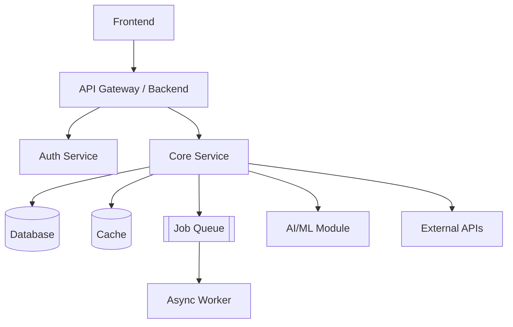

# Technical Design Template — CS Engineering Projects

Fill-in-ready technical design for AI/ML, web, cloud, security, and hackathon projects. Bracketed text is a placeholder; delete example lines when done.

---

## Project Info

| Field | Value |
| --- | --- |
| Project Name | [Enter project name] |
| Version | v0.1 |
| Owner | [Name / Team] |
| Date | [YYYY-MM-DD] |
| Related PRD / SRS | [PRD link] / [SRS link] |
| Status | Draft / Review / Approved |

---

## 1. Architecture Overview

- **Frontend:** [React / Next.js / Streamlit / React Native / CLI]
- **Backend:** [FastAPI / Node / Flask / Go / serverless]
- **Database:** [PostgreSQL / SQLite / MongoDB / Redis / vector DB]
- **External services:** [Auth, LLM, email, storage, payments]
- **Deployment:** [Docker, AWS ECS, Vercel, Render, local]
- **Style:** [Monolith / modular monolith / microservices / pipeline / serverless]

---

## 2. Architecture Diagram

Simplify for small projects — a single service + DB is often enough.

---

## 3. Technology Stack

| Layer | Technology | Reasoning |
| --- | --- | --- |
| Frontend | [Tech] | [Familiarity, ecosystem, speed] |
| Backend | [Tech] | [Performance, libs, async] |
| Database | [Tech] | [Query patterns, scale] |
| AI / ML | [Tech] | [Hosted vs self-hosted: cost, latency, privacy] |
| Infrastructure | [Tech] | [Scalability, cost, ease of deploy] |
| DevOps | [Git, Docker, GitHub Actions] | [Reproducibility, automation] |

---

## 4. Database Design

| Table | Key fields | Relationships | Indexes |
| --- | --- | --- | --- |
| users | id, email, password_hash, role | 1:N resources | unique(email) |
| [resource] | id, user_id, data, status, created_at | N:1 users | index(user_id, status) |
| audit_logs | id, actor_id, action, ts | N:1 users | index(ts) |

**Conventions:** UUID PKs, `created_at`/`updated_at` on every table, `deleted_at` for soft delete, enums for status.

---

## 5. API Design

| Method | Endpoint | Purpose | Auth |
| --- | --- | --- | --- |
| POST | /api/v1/auth/login | Issue token | No |
| GET | /api/v1/resource | List (paginated) | Yes |
| POST | /api/v1/resource | Create (validated) | Yes |
| GET | /api/v1/resource/:id | Fetch one | Yes (owner/admin) |
| PUT | /api/v1/resource/:id | Update | Yes (owner/admin) |
| DELETE | /api/v1/resource/:id | Soft delete | Yes (admin) |
| GET | /health | Health check | No |

**Conventions:** version (`/v1`), JSON, standard status codes (401/403/404/422/429), paginate lists, publish OpenAPI docs.

---

## 6. Auth & Authorization

- **Session:** [JWT in HttpOnly/Secure/SameSite cookie; 15 min access + refresh]
- **Passwords:** [bcrypt or argon2; never plaintext]
- **RBAC:** [Admin / Member / Guest per SRS]
- **Secrets:** [`.env` local (git-ignored), GitHub Secrets in CI, AWS Secrets Manager in prod]

---

## 7. Data Flow

**Sync path**
1. User acts → API request.
2. Gateway authenticates + routes. Controller validates payload.
3. DB transaction → formatted response to UI.

**Async path**
[Upload / webhook → job to queue (Redis/RabbitMQ/SQS) → worker processes → status stored → user notified (polling / WebSocket / email).]

---

## 8. AI / ML Architecture

Fill Path A, Path B, or both. Delete what you don't use.

### Path A: Generative AI / LLM
- **Model / provider:** [Gemini / GPT / Llama via Groq or Bedrock / local Ollama]
- **Architecture:** [Single prompt / tool-calling agent / multi-agent graph]
- **RAG:** [Embedding model, chunk size, store (pgvector/Chroma/Pinecone), top-k]
- **Guardrails:** [Prompt-injection filter, output schema validation, safety classifier, eval set]
- **Fallback:** [Timeout → retry → secondary model → cached/heuristic → clear UI error]
- **Cost control:** [Token caps, caching, rate limits]

### Path B: Traditional ML / DL
- **Task type:** [Classification / regression / forecasting / detection / segmentation]
- **Frameworks:** [Scikit-learn / XGBoost / PyTorch / TensorFlow]
- **Preprocessing:** [Imputation, scaling, encoding, augmentation, train/val/test split]
- **Training / artifacts:** [Offline; weights in MLflow / DVC / object storage]
- **Inference:** [Batch (cron) or real-time (FastAPI + ONNX Runtime)]
- **Monitoring:** [Evidently or custom drift checks; retraining trigger]
- **Metrics:** [Accuracy, F1, mAP, latency]

---

## 9. Security

- Object-level authorization checks on every data query
- Schema validation (Pydantic / Zod / Joi); sanitize all input
- TLS 1.2+ in transit; encryption at rest
- Rate limiting: [X req/min per user/IP]
- No secrets in repo; rotate keys
- Dependency scanning (Dependabot / `pip-audit` / `npm audit`)
- LLM-specific: treat retrieved + user content as untrusted; restrict tool permissions
- Audit sensitive actions; never log secrets or PII

---

## 10. Deployment & Infrastructure

- **Hosting:** [Frontend on Vercel/Netlify; backend in Docker on EC2/Fargate/Render]
- **CI/CD:** [GitHub Actions: lint → test → build → deploy]
- **Monitoring:** [CloudWatch / Grafana / Sentry; uptime check on `/health`]
- **Backups:** [Daily DB snapshots; tested restore; RPO/RTO]
- **Environments:** [Local → staging → production]

---

## 11. Trade-offs & Rejected Alternatives

| Decision | Chosen | Reason | Rejected | Reason rejected |
| --- | --- | --- | --- | --- |
| Architecture | Monolith | Fast to build, simple deploy | Microservices | Over-engineered for MVP |
| AI provider | Hosted API | No GPU cost, quick start | Self-hosted | Infra + cost overhead |
| Database | Postgres | Relational data, strong tooling | MongoDB | Data is highly relational |

---

## 12. Implementation Plan

- **Phase 1 — Foundation:** repo, DB schema, auth scaffold, CI
- **Phase 2 — Core:** main services + CRUD endpoints, basic UI
- **Phase 3 — AI / integrations:** model or LLM, embeddings, external APIs, webhooks
- **Phase 4 — Test & deploy:** unit + integration tests, load test, security review, prod deploy, docs + demo

---

## 13. Design Review Checklist

- [ ] Every SRS functional requirement maps to a component
- [ ] Every NFR has a design answer
- [ ] Failure modes and fallbacks defined
- [ ] Cost / free-tier limits verified
- [ ] Security review done
